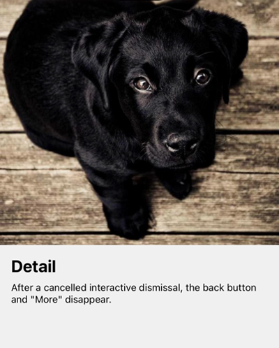
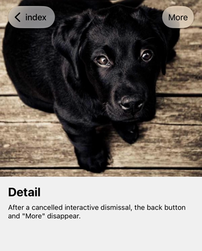

# react-native-screens: header invisible after a cancelled zoom dismissal

Minimal repro for a react-native-screens (iOS 18+) bug.

A screen pushed with UIKit's zoom transition (expo-router `Link.AppleZoom`, which sets `preferredTransition = .zoom`) loses its header items when the interactive dismissal is cancelled, if the screen below has `headerShown: false`. The navigation bar is left with `alpha == 0`.

## Run

```sh
npm install
npx expo run:ios
```

## Steps

1. Tap the photo on Home. Detail opens with a zoom transition and shows a back button and "More".
2. Start dragging Detail down (or swipe from the leading edge) and release early, so it springs back.
3. The back button and "More" are gone.

Versions: Expo SDK 58, expo-router 58.0.26, react-native 0.88.0, react-native-screens 4.30.0.

## Recordings (iPhone 18 Pro simulator, iOS 27.0 — idle time cut, the drag sped up 2.5x)

- [Before](media/before.mp4): react-native-screens 4.30.0 — after the cancelled drag, the back button and "More" are gone.
- [After](media/after.mp4): with the fix from software-mansion/react-native-screens (branch `dongriDK:fix/zoom-cancel-navbar-alpha`) — both stay.

| Before (after a cancelled drag) | After |
| --- | --- |
|  |  |
